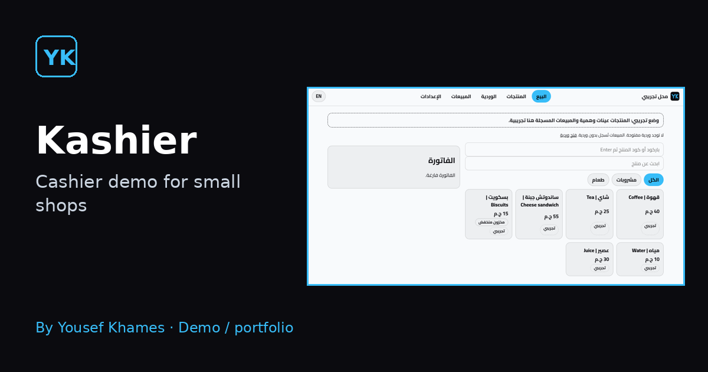

<div align="center">


# kashier

**kashier** · demo / portfolio project

**كاشير تجريبي للمحلات الصغيرة** · مشروع تجريبي للعرض

[Live demo](https://yousefkhames.github.io/kashier/) · By Yousef Khames · من تطوير يوسف خميس



</div>

---

# kashier · كاشير

A white-label cashier (POS) web app for small shops: product tiles, barcode or code entry, cart, discounts, owner-set tax, cash/card/other payment *labels*, change calculator, 58/80 mm receipt printing, stock counts with low-stock flags, shifts with cash count, refunds, CSV import and export. Arabic RTL and English LTR. Static HTML, CSS and JavaScript; no build, account, API or payment processor.

<div lang="ar" dir="rtl">كاشير لمحلات صغيرة: فاتورة، خصم، إيصال، مخزون، ورديات، ومرتجعات. لا تتم أي معالجة دفع، فقط تسجيل لما استلمته. البيانات على هذا الجهاز فقط.</div>

 **By Yousef Khames · من تطوير يوسف خميس**

## Preview locally

```sh
python3 -m http.server 8080 --bind 127.0.0.1
```

Open `http://localhost:8080/` in a fresh browser profile. The sample products are **demo**: fictional items and prices, tagged Demo. No sales are pre-filled: every figure in Shift and Sales comes only from sales you record. Sales made with demo products are tagged demo. Screenshots in `docs/` use demo data only.

## Set up a shop

1. **Settings**: shop names, currency label, tax rate and receipt width (58 or 80 mm). The tax rate ships at **0**; set the rate that applies to you. Prices are entered without tax; tax is added after discount.
2. **Products**: press **Clear demo data** (Settings), then add products by hand or import a CSV with columns `name, price, category, code, stock, low_stock_at`. Leave stock empty to not track it. Export CSV to edit in a spreadsheet.
3. **Selling**: tap a tile, or type or scan a code into the barcode box and press Enter (USB scanners that type like a keyboard work). Choose a discount and a payment type, enter cash received for change, then **Complete sale**. Print the receipt or open a WhatsApp draft to the customer (opens a draft only).
4. **Shift** (optional): open with the cash in the drawer, close with the cash you counted. The app shows expected cash from recorded cash sales and the difference.
5. **Sales**: reprint receipts, **full refund** (restores stock, recorded as a negative sale, one refund per sale), export CSV.
6. **Owner PIN** (optional) gates Products, Shift, Sales and Settings. It is a convenience, not security.
7. Theme: edit `assets/kit-theme.js`. Keep `assets/yk-logo.svg` and `assets/favicon.svg`.

## Deploy (GitHub Pages)

Create `yousefkhames/kashier`, commit these files to `main`, Settings → Pages → Deploy from a branch → `main` / root. Live at `https://yousefkhames.github.io/kashier/`. After the first load it works offline. Install it from the browser menu to use it like an app.

## Tests

```sh
npm run test:unit  # Node 22+
npm run test:e2e   # headless Chrome as google-chrome
npm test
```

## Honest limits and privacy

- **No payments.** Card and other are labels. Nothing is charged, authorised or reconciled with a bank. Check card takings against your own terminal.
- **One device, no sync.** Several tills would each have their own data. Data lives in the browser; clearing site data erases it. Export a full backup regularly (it contains sales: keep it private).
- **Not a tax system.** This is not an e-invoice or e-receipt, and does not connect to any tax authority. Receipt numbers are a simple counter.
- Refunds are full-sale only. Stock counts are what you enter plus recorded sales and refunds; they are not audited inventory.
- Shift and daily figures count recorded sales only and use the device clock and time zone.
- Browser storage has a size limit (a few MB). A shop with very many sales should export and reset periodically.
- The PIN can be bypassed by anyone with access to the browser data. Customer numbers typed for a WhatsApp receipt are not stored.
- Contrast of default theme pairs is checked; no blanket WCAG claim; not tested on real POS hardware or printers.

## License

MIT, copyright Yousef Khames. See `LICENSE`. Cairo font: SIL OFL. `assets/qrcode.js`: qrcode-generator by Kazuhiko Arase (MIT, `assets/qrcode.LICENSE.txt`) is bundled in the shared base but not used by this kit.

> Demo / portfolio project. Static GitHub Pages site with fictional sample data. It is not a certified point-of-sale or payment system.
