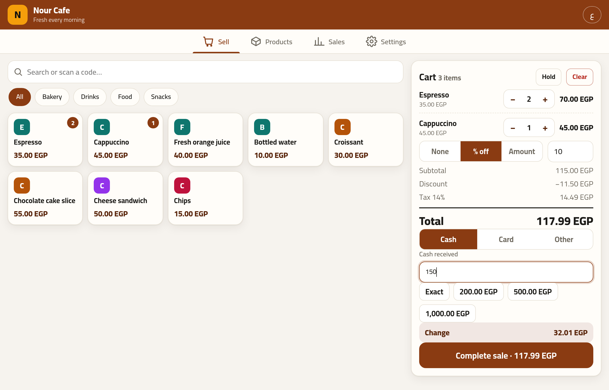
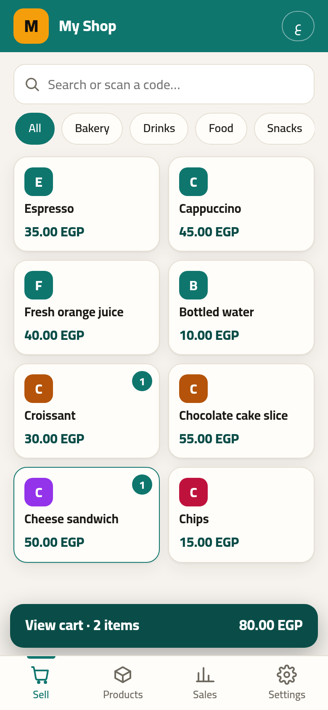
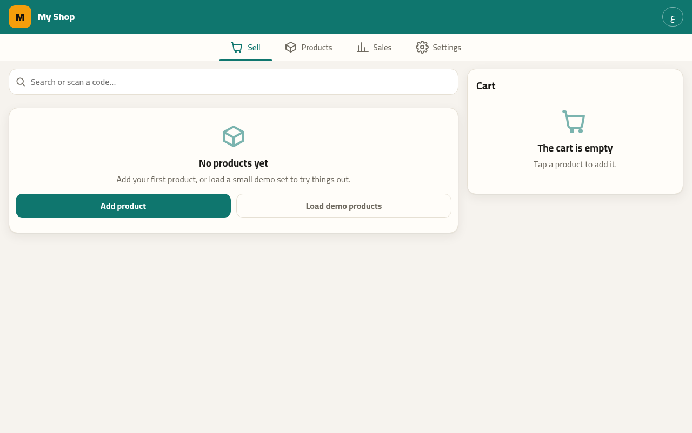
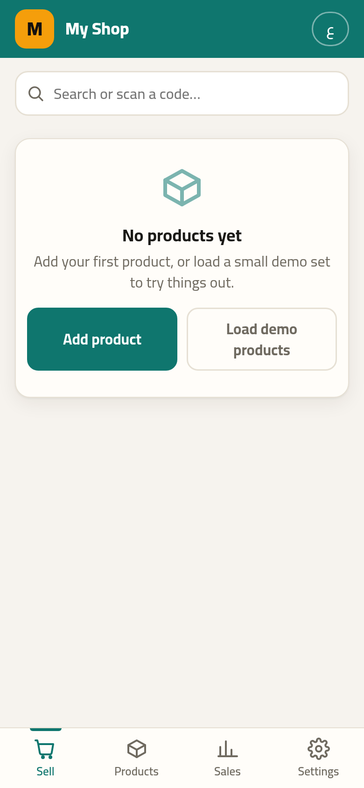
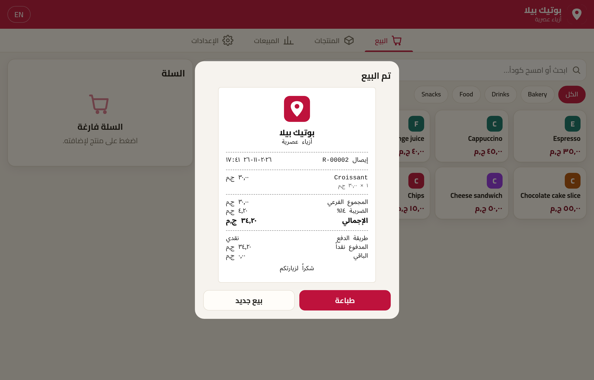
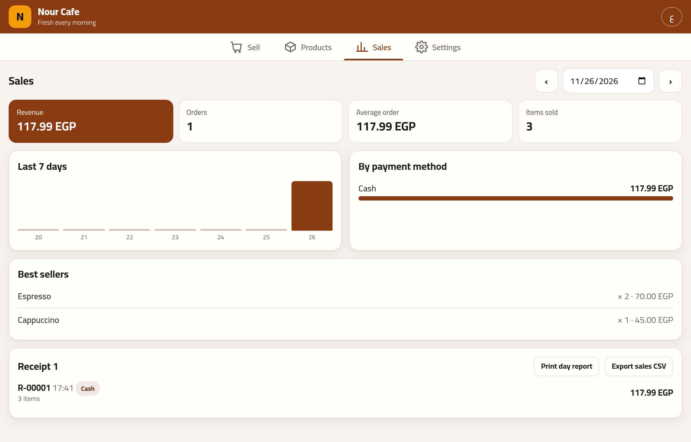
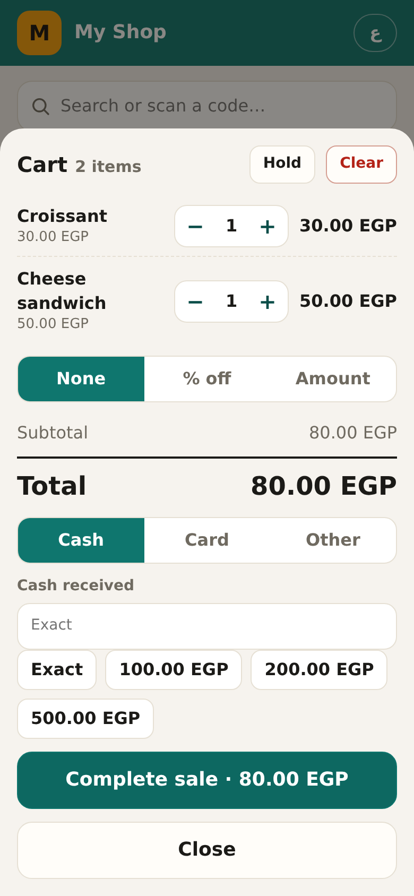
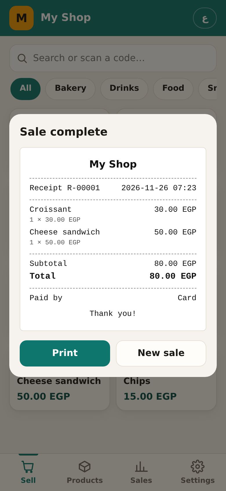
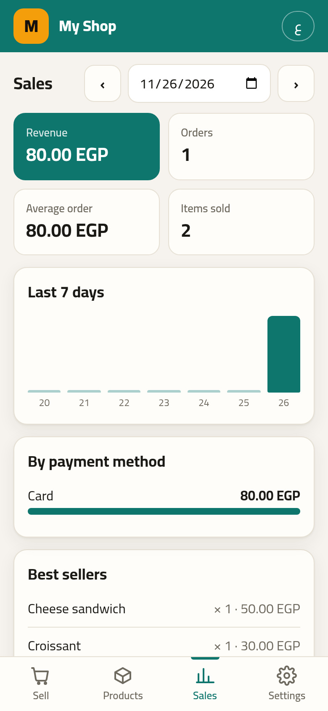
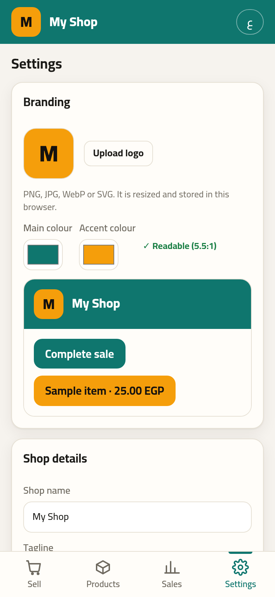

<p align="center"></p>

<h1 align="center">Kashier | كاشير</h1>

<p align="center"><b>A white-label cashier for small shops. One codebase, any shop's name, logo and colours.</b><br>
Works offline in the browser. No server, no account, no monthly fee. Arabic and English with full RTL.</p>

<p align="center"><a href="https://yousefkhames.github.io/kashier/"><b>Open the live app</b></a></p>

<p align="center">


</p>

## Screenshots

Captured from the live site (https://yousefkhames.github.io/kashier/).

<p>
  
  
</p>

## The pitch

A coffee kiosk, a clothing shop or a corner grocery does not need a monthly POS subscription. It needs a screen where you tap products, take cash, print a receipt and see what you sold today. Kashier does that, and it re-skins in seconds: shop name, logo, colours, currency, language and receipt text all live in a settings screen and export to a small JSON file. Make the file once per client, import it on their device, hand it over.

## Features

- **Sell**: product tiles with search, category chips and stock badges, a cart with quantity steppers, percent or fixed discount, tax (added on top or already included), cash with quick amounts and change due, card or other.
- **Scan or type a code**: type a SKU in the search box and press Enter to add it. A USB barcode scanner that types and presses Enter works the same way.
- **Hold and resume carts** for customers who step away.
- **Receipts**: numbered (prefix is configurable), with logo, address, tax ID and footer text. Print from the browser (print layout is receipt-only).
- **Daily totals**: revenue, orders, average order, items sold, 7-day chart, split by payment method, best sellers, a printable day report, and a sales CSV export. Browse any past day.
- **Void a sale**: stock goes back, the day total updates, the receipt is stamped VOID.
- **Products**: add, edit, delete, categories, optional stock tracking, CSV import and export (with a guard against spreadsheet formula injection).
- **White-label settings**: shop name, tagline, address, phone, tax ID, logo upload (resized in the browser), main and accent colour with a live contrast check, currency symbol and position, decimals, Arabic-Indic digits, language, tax, receipt prefix and footer, which payment methods to offer.
- **Brand file**: export just the branding as JSON, import it on another device. Products and sales are not included.
- **Full backup and restore** as JSON.
- **Arabic and English**, right-to-left layout done with logical CSS properties, one-tap language switch.
- **Mobile first**: bottom tab bar and cart sheet on phones, side cart on desktop.
- **Offline**: a service worker caches the app after the first visit.

<p align="center">


</p>
<p align="center">




</p>

## Set it up for a client

1. Open the app, go to **Settings**, fill in the shop's name, logo, colours, currency and tax.
2. Go to **White-label kit** and press **Export brand file**.
3. On the client's device, open the app and press **Import brand file**. Load their products from a CSV in **Products**.
4. To ship it under your own domain, fork this repo and enable GitHub Pages, or copy the folder to any static host. There is no build step.

## Tech

Plain HTML, CSS and JavaScript. No framework, no build, no runtime dependencies, no external fonts or CDNs. Money is stored as integer minor units so totals never drift. Data lives in `localStorage`.

```
index.html          app shell
css/style.css       design, theming via CSS variables, print styles
js/core.js          pure logic: money, cart maths, totals, CSV, brand validation
js/i18n.js          English and Arabic strings
js/app.js           UI
sw.js               offline cache
tests/unit.test.js  15 unit tests (node:test)
tests/e2e.js        27 browser checks (headless Chrome via puppeteer-core)
```

## Run and test

```bash
npm run serve        # http://localhost:8080
npm test             # unit tests, no install needed
npm i && npm run test:e2e   # real browser click-through; needs Google Chrome or Chromium
SHOTS=1 npm run test:e2e    # also regenerates the screenshots in docs/
```

The browser test covers: demo data, live branding, tax and discount maths, cash change, checkout and receipt, stock guards, SKU scan, hold and resume, daily totals, void, day report, product CRUD, CSV import, brand export and import, backup and restore, RTL, print layout, persistence, phone layout without horizontal overflow, tap target size, and no console errors.

## Honest limits

- **Data stays in one browser on one device.** There is no sync between devices or staff logins. Clearing site data erases it. Use **Download backup** regularly.
- **It is a sales register, not an accounting system.** No supplier purchases, no refunds of single items (you void the whole receipt), no customer accounts, no cash drawer count.
- **Tax is one flat rate.** It is not a certified fiscal device and does not connect to any e-invoicing authority. Check your local rules before relying on the receipts for tax.
- **Card payments are only recorded, not processed.** There is no card terminal integration.
- **Printing uses the browser print dialog.** Direct ESC/POS thermal printer support is not included. A browser printing to a thermal printer works with the receipt-only print layout.
- **Decimals are locked once products or sales exist**, because stored amounts depend on them.
- **Tested in headless Chrome** (desktop and phone sizes). Not tested on iOS Safari or on real hardware.
- Logos are resized to 256 px and stored in the browser.

## License

[MIT](LICENSE). Use it, change it, sell it to your clients.

## Fonts, import and limits (round 2)

- Cairo (SIL OFL) is bundled in `fonts/` as woff2 and precached by the service worker, so Arabic text looks the same offline and no request goes to Google.
- CSV product import accepts comma, semicolon or tab separated files (Excel in Arabic locales saves with semicolons) and decimal commas.
- Typed amounts above 1,000,000,000 are refused (float precision). Percent and tax fields accept Arabic digits.
- No camera barcode scanning. The search box takes a USB or Bluetooth scanner (they type the code and press Enter, which adds the SKU to the cart). Browser camera scanning (`BarcodeDetector`) is not available on desktop Chrome for Windows/Linux or Firefox/Safari, and could not be tested on a real camera here, so it was left out rather than shipped half-working.
- Printing uses the browser print dialog (receipt only, 76 mm layout). Data lives in this browser's localStorage: back it up from Settings.
